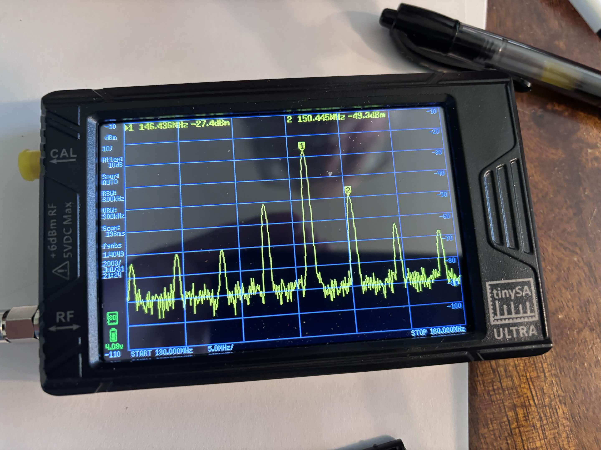
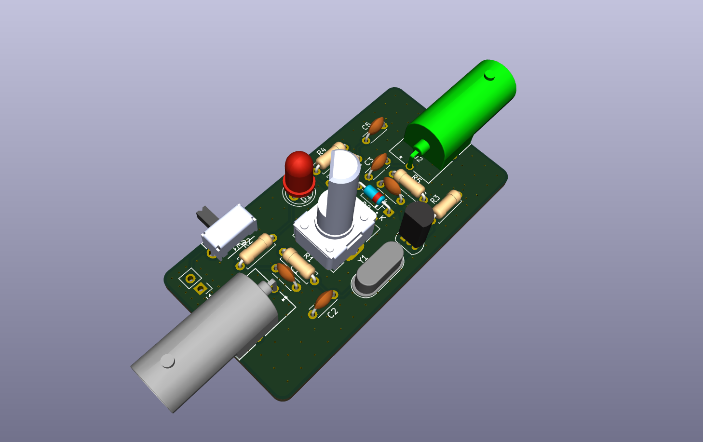
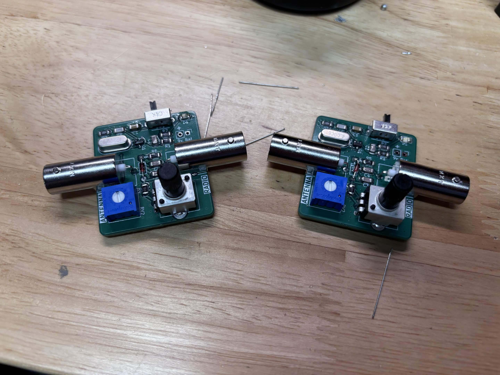

# FoxHunt Offset Attenuator
A simple foxhunt offset attenuator! Original circuit design by John KC9ON. More information coming soon!

This project was made 100% WITHOUT AI. We do not use AI for Grilled Cheese Engineering Projects.

## How it Works

This style of attenuator is very simple to operate but very powerful. It is operated with just a single potentiometer to adjust the attenuation power. A 4.00MHz clock is "injected" into the RF signal which creates an effect called intermodulation which creates attenuated versions of the frequency 4.00MHz up and down. Below is a picture from a test using the V1 Attenuator. 

The large peak is the frequency that something is transmitting and peak to the left and right is 4.00MHz from the transmit frequency. On the most sensitive mode, there is 25dBm attenuation already!

While fox hunting, tune either 4.00MHz up or down to listen to the attenuated signal.

## Attenuator Versions

### V2 Attenuator

This is the V2 attenuator. This revised and updated version of the attenuator incorporates a few key improvement and modifications. It is a cross between the V7 and V5 attenuator by John KC9ON. One of the biggest changes is a shift from SMD to Through Hole parts so it can be easily assembled and sold as a kit. It also only has a single potentiometer which makes the attenuator easier to operate.

This render of the PCB is not final and is a WIP. It should be done very soon so check back in a couple days.

I will be also making an alternate layout of this PCB to fit in a Lowes PVC Conduit so it can be integrated directly into a yagi antenna. More info on that soon

---

### V1 Attenuator

This is the V1 attenuator. This version was made with primarly SMD parts and based on John KC9ON's V5 Offset Attenuator. This version is not available any more because I made a better version and there is no reason to use this one anymore.

## Credit

This attenuator was adapted from John KC9ON's Offset Fox hunt attenuator. Check out his website here [KC9ON.com](https://kc9on.com). 

## Commercial Use

Grilled Cheese Engineering plans to sell this attenuator design online soon and has acquired permission from the original designer of the circuit (John KC9ON) to sell this attenuator online.

## Notes

If you try pulling this project yourself, some component symbols might be missing and you will have to download and install them yourself. This is because I was silly and didn't put all of the part libraries in this project.
