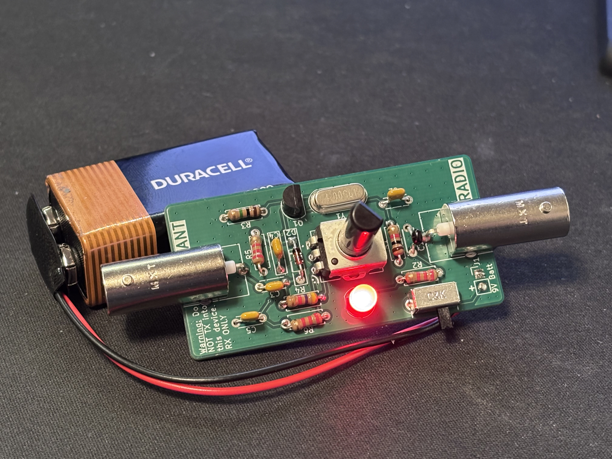
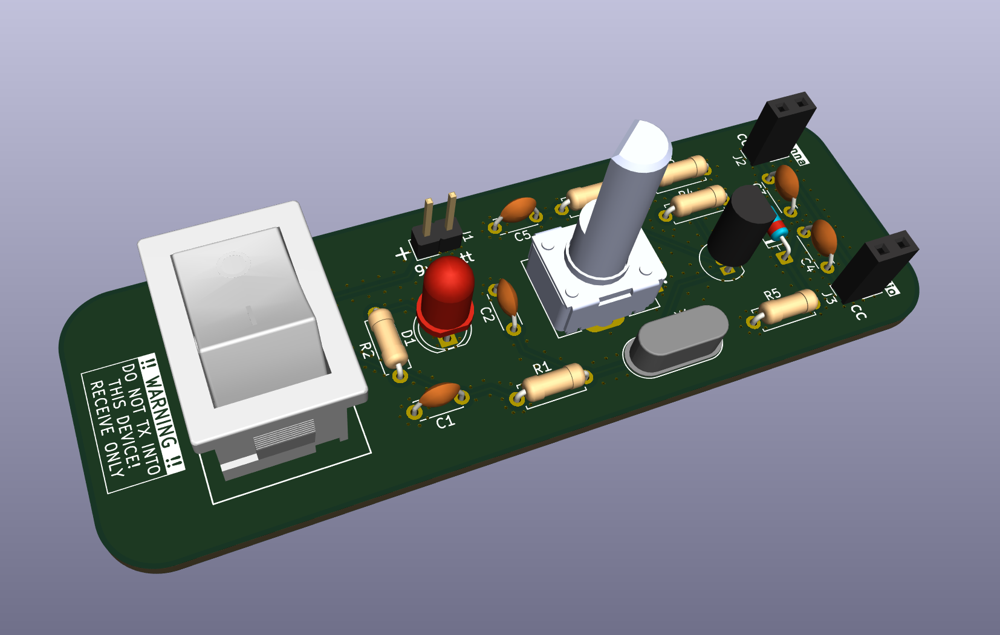
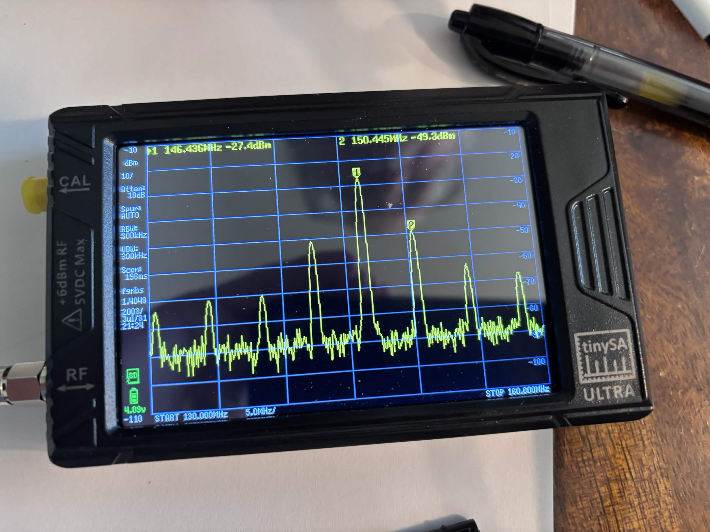
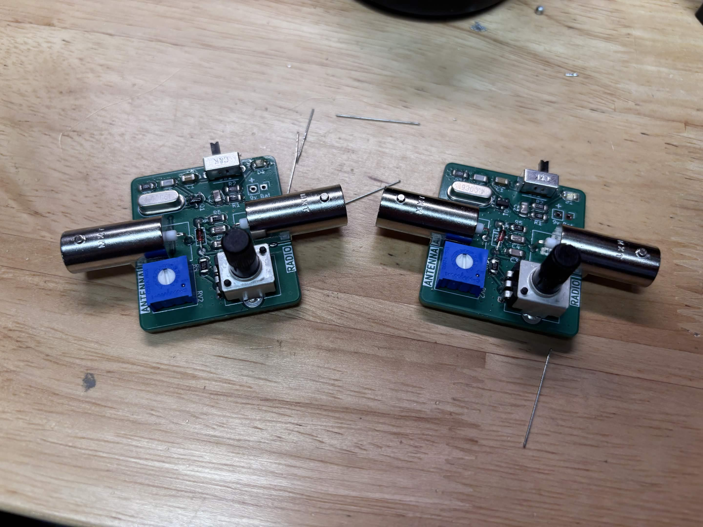

<h1 class='big-title noline'><b>FoxHunt Offset Attenuator</b></h1>

    
    
    

 
A simple foxhunt offset attenuator for radio direction finding! Original circuit design by John KC9ON. More information coming soon!

This project was made **100% WITHOUT AI**. We do not use AI for Grilled Cheese Engineering Projects.

This will be coming to our website for purchase very soon once I finish some stuff so keep your eyes out :)

# How it Works

The concept behind this attenuator is very simple but powerful. The attenuator can be operated with a single potentiometer. When the device is powered on, a 4.00MHz clock is generated and "injected" into the RF signal that is being received. That creates an effect called intermodulation where the primary frequency is "duplicated" 4.00MHz up and down from the primary frequency. While using the attenuator, tune your radio to those offset frequencies.

The additional peaks that result from this effect are significantly weaker than the primary frequency. This is useful as you get closer to the location of the transmitter as the signal will sound strong from all directions while you sweep. As the sensitivity is decreased, only the strongest signals reach your radio.

The large peak is the frequency that something is transmitting and peak to the left and right is 4.00MHz from the transmit frequency. On the most sensitive mode, there is 25dBm attenuation already!

While fox hunting, tune either 4.00MHz up or down to listen to the attenuated signal.

<h1 class="noline">Attenuator Versions</h1>

---

<h2  class='noline'>V2 Attenuator</h2>

<h3> Layout Version A </h3>

This is the A version of the V2 attenuator. This revised and updated version of the attenuator incorporates a few key improvement and modifications. It is a cross between the V7 and V5 attenuator by John KC9ON. One of the biggest changes is a shift from SMD to Through Hole parts so it can be easily assembled and sold as a kit. It also only has a single potentiometer which makes the attenuator easier to operate.

The V2 is also a tad cheaper than the V1 and the board is larger in size so a 9v battery fits behind it perfectly.

### Layout Version B

This is the B version of the V2 Attenuator. This has all of the same functonality and (almost) all the same parts as layout A. This layout of the board is designed specifically to fit in a Lowes/Home Depot PVC conduit. This means the attenuator can be built directly into your Yagi antennas boom. It also lacks BNC connectors and has a larger power switch. This PCB is not ready yet and before it can be brought to market I will be making a custom 3d printed faceplate for the anttenuator. Check back for updates soon!

---

<h2 class='noline'>V1 Attenuator</h2>

This is the V1 attenuator. This version was made with primarly SMD parts and based on John KC9ON's V5 Offset Attenuator. This version is not available any more because I made a better version and there is no reason to use this one anymore.

# Credit

This attenuator was adapted from John KC9ON's Offset Fox hunt attenuator. Check out his website here [KC9ON.com](https://kc9on.com). 

# Commercial Use

Grilled Cheese Engineering plans to sell this attenuator design online soon and has acquired permission from the original designer of the circuit (John KC9ON) to sell this attenuator online.

# Notes

If you try pulling this project yourself, some component symbols might be missing and you will have to download and install them yourself. This is because I was silly and didn't put all of the part libraries in this project.

<footer></footer>